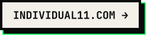
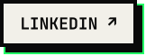

<a href="https://individual11.com">
  <picture>
    <source media="(max-width: 600px)" srcset="https://raw.githubusercontent.com/individual11/individual11/output/header-narrow.svg">
    
  </picture>
</a>

 

  
  
  

### `whoami()`

I co-founded Buddy and ran technology there from 2017 to 2026. That meant building the team, the platform, and ION, a data format that once took an insurance product live in 18 hours. Before that I was an ACD, Creative Technologist, and copywriter at The Martin Agency, where I started the Martin Lab.

### `ls ./projects`

- [**headwaiter**](https://github.com/individual11/headwaiter) `Swift` Keeps track of the dev servers running on your Mac.
- [**padpal**](https://github.com/individual11/padpal) `Swift` Per-app layouts and colors for the Work Louder Creator Micro, on stock firmware.
- [**crayonbox**](https://github.com/individual11/crayonbox) `TypeScript` Style guides in plain text: easy for LLMs to write, checked before they ship.
- [**boidsjs**](https://github.com/individual11/boidsjs) `TypeScript` Flocking algorithms with zero dependencies. [See them fly](https://boidsjs.com).
- [**row_row**](https://github.com/individual11/row_row) `TypeScript` A browser dashboard for Bluetooth rowing machines. Nothing leaves your device.

<code>cat ./header.svg</code>

 

The header is my last year on GitHub. Green squares are days with a contribution, dots are days without. Squares step along a grid, dots drift.

It's one SVG with CSS animation, no JavaScript and no fonts (the type is baked to outlines). [One script](scripts/build.mjs) draws it and an [Action](.github/workflows/header.yml) redraws it every day. It holds still if you prefer reduced motion.

<code>sudo</code>

 

nice try.

